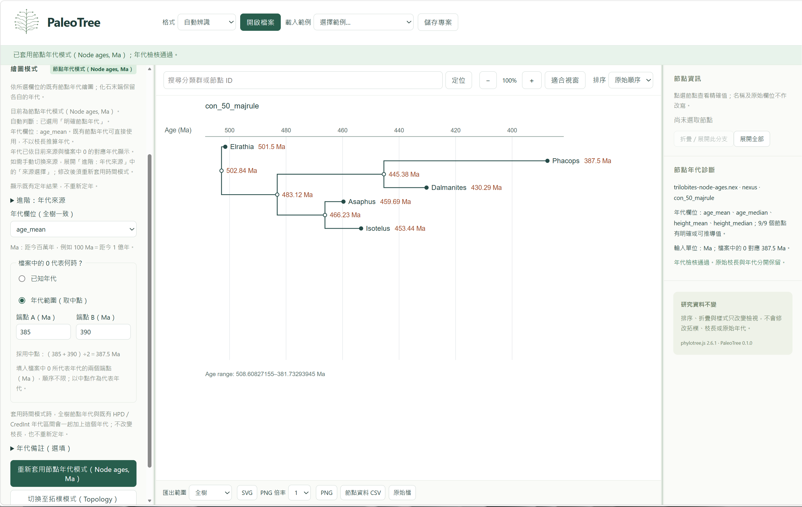

# PaleoTree

許多常見 Tree Viewer 的使用情境偏向分子演化與序列分析，雖然也能呈現時間樹與化石資料，但不一定以古生物研究的年代判讀需求為核心。PaleoTree 則將化石末端具有不同年代、檔案中的時間原點不一定是現在，以及部分節點年代未知等情境，納入主要操作流程。它不只畫樹，更依資料區分原始枝長、相對時間與絕對年代，自動判別五種顯示模式，檢查父子節點的年代順序，避免把演化變化量誤當時間，或把未知年代誤當成現生。使用者可核對節點精確值與年代來源，在保留原始資料、不重新推估年代的前提下檢視既有結果。軟體支援正體中文與英文，以單一 HTML 完全離線執行，無須安裝或上傳資料，適合研究檢查、教學與未發表資料的本機檢視。



## 開始使用

1. 下載 [paleo-phylotree.html](dist/paleo-phylotree.html)，以 Microsoft Edge 開啟。只需這個檔案，無須安裝、連網或啟動伺服器。
2. 按「開啟檔案」、拖入樹檔，或從「載入範例」選取資料。
3. 系統自動判定 Tree Type；多樹檔可從「樹」選單切換，每棵樹獨立判定。
4. 確認年代欄位、時間原點與枝長語意。修改設定後會自動重新分類；「重新判定與套用」按鈕僅在 Dated Tree／Chronogram 顯示，其餘三種模式隱藏。
5. 點選節點查看精確值，再匯出圖片、CSV 或儲存專案。

## 介面語言

- 開啟頁面時依瀏覽器的第一偏好語言自動選擇：所有中文語系（含 `zh-TW`、`zh-CN`、`zh-Hans`）統一顯示**正體中文**；英文與其他所有語系顯示**英文**。不會因次要偏好包含中文而切換。變更瀏覽器語言後，重新載入頁面即可套用。
- 按鈕、選單、說明、提示、錯誤、節點資訊欄位與無障礙標籤使用相同語系；五種模式名稱、圖內文字、軸標題及匯出欄名維持英文。
- 分類群名稱、樹名、原始註解、使用者備註及來源檔案不翻譯。專案不儲存介面語系，跨語系開啟時採用當下瀏覽器語言。
- 翻譯完全內嵌於離線 HTML，不連線取得語言資源。

### 擴充語言

[src/i18n.ts](src/i18n.ts) 集中管理語系判定、型別化訊息目錄及參數插值；[src/locales/en.ts](src/locales/en.ts) 以穩定的正體中文原文為訊息鍵，正體中文目錄直接使用原文。
新增語言時，在 `src/locales` 建立完整的 `Messages` 目錄（可使用 `satisfies Messages` 檢查漏譯），保留訊息中的 `{0}`、`{1}` 等參數，再於 `locales` 登錄目錄與語言標籤比對規則；無須修改分類或繪圖邏輯。
新增介面文字應加入目錄，動態訊息使用 `t()`；靜態 HTML 使用 `data-i18n`，屬性使用 `data-i18n-title`／`data-i18n-placeholder`／`data-i18n-aria-label`。不得對原始研究資料做全頁字串替換。
完成後執行下方驗證並重新建置單檔 HTML。

## 五種顯示模式

| Tree Type | 判定條件 | X axis |
|---|---|---|
| Dated Tree | 所選年代欄位的所有內部節點年代有效，已知父子年代順序正確；優先使用明確年代，不以枝長覆寫 | Age (Ma) |
| Chronogram | 枝長已確認代表時間，具有既有絕對年代錨點，且可唯一、一致推導全樹年代 | Age (Ma) |
| Relative Chronogram | 枝長已確認代表時間，枝長完整，但沒有任何絕對年代錨點 | Relative time |
| Phylogram | 存在枝長，但時間語意未驗證或無法通過時間檢核 | Branch length |
| Cladogram | 所有非根分支均沒有枝長，且無有效節點定年 | Equal steps |

資訊優先順序為 **Dated Tree → Chronogram → Relative Chronogram → Phylogram → Cladogram**。這是資料分類，不是五個可任意套用的樣式。

- 年代欄位支援 `age`、`age_mean`、`age_median`、`height`、`height_mean`、`height_median`，以及 `date`、`time` 的相同形式；全樹選用同一欄位，不逐節點混用 mean／median。
- 所有年代必須是有限非負值，父節點不得比已知子節點年輕。明確未定根的樹不顯示時間尺度；未記錄定根狀態時，先選「使用目前的根」。
- **時間單位與欄位語意須由原分析確認**。應用程式的絕對年代輸入固定使用 Ma；其他單位必須先換算，不因檔名、副檔名或等長根端距離而認定已定年。
- Dated Tree 允許末端年代缺失：以虛線連到圖的較新邊界，標示 `Age unknown`，僅表達拓樸；該位置不是估計年代，CSV 年代留空。不自動假設現生或 0 Ma。
- Phylogram 保留已知枝長比例，包括全部為 0 的資料。部分缺枝長仍屬 Phylogram，顯示警告及虛線未知連接，不補成 1。Cladogram 每條分支固定等長，不強制末端對齊。
- Relative Chronogram、Phylogram 與 Cladogram 的 OTU 均採縱向等間距，父節點位於可見子節點的縱向中點；排序、折疊與字級調整後重新排列，橫軸比例不變。Dated Tree／Chronogram 維持依標籤避讓的縱向排版。

### 確認時間枝長

接受根節點上的明確註解：

```text
((A:10,B:10):20,C:30)[&branch_length_unit=relative_time];
((A:10,B:10):20,C:30)[&branch_length_unit=Ma,root_age=100];
```

`relative_time` 或 `Ma` 均明確宣告枝長代表時間；**單位宣告本身不是絕對年代錨點**。第一例為 Relative Chronogram，第二例為 Chronogram（另須有定根標記或確認）。「已確認枝長代表時間」及其說明只在缺少上述宣告、枝長完整且未明確標記未定根、並需要以枝長解讀時間時顯示；已有可用節點年代的 Dated Tree 不顯示，除非在進階來源選擇改用時間枝長。可依原分析證據勾選，不確定時保持未勾選；手動勾選後仍保留選項，方便取消。

Chronogram 錨點支援所選年代欄位、根節點 `root_age`、各節點 `node_age`／`tip_age`／`calibration_age` 的明確數值。`calibration_age` 表示已知確定年代；僅有範圍約束不能唯一決定年代，本版會回報錯誤，不擅自取中點。多錨點必須彼此與枝長一致；無效錨點不視為「沒有錨點」而退成 Relative Chronogram。

### 範例與功能測試

下拉選單與檔名按五種模式命名，載入即自動分類；切換範例會重設年代與檢視設定。

| 範例 | 預期模式與驗證重點 |
|---|---|
| [dated-tree.nex](examples/dated-tree.nex) | Dated Tree：三葉蟲既有節點年代、TRANSLATE、支持度與 HPD；可測試時間原點平移 |
| [chronogram.nex](examples/chronogram.nex) | Chronogram：唯一根錨點 100 Ma，根的兩個子群為 50、66 Ma；OTU01–OTU15 年代依序為 20、0、35、0、10、15、20、25、30、35、40、45、50、55、60 Ma |
| [relative-chronogram.nex](examples/relative-chronogram.nex) | Relative Chronogram：已宣告時間枝長，無錨點；根的兩個子群距離為 20、10，15 個末端的根距離皆為 30，不顯示 Ma |
| [phylogram.nex](examples/phylogram.nex) | Phylogram：替換量枝長；OTU01、OTU02 的根距離為 0.4、0.5，OTU03–OTU15 為 0.4–1.6（間隔 0.1），不顯示 Ma |
| [cladogram.nex](examples/cladogram.nex) | Cladogram：沒有枝長，固定等長分支；支持度不作年代解讀 |

合成範例僅供測試與操作練習，不代表科學推論。除 dated-tree.nex 外，四個範例的所有節點均提供支持度；缺失值以 0.71–1 的隨機示範值補齊，保留原有值，不代表分析結果。三葉蟲範例不預填化石時間原點，也不宣稱已驗證原始分析的單位。

## 檔案中的 0 代表何時？

- **0 代表現在**：選「已知年代」，保持 0。
- **0 代表最年輕化石**：填入該化石的 Ma 年代，例如 380。
- **已知範圍**：選「年代範圍（取中點）」，填入兩個非負端點，順序不限。例如 385 與 390 的中點為 387.5 Ma。

僅在絕對年代模式對有效節點年代及 HPD／CredInt 加上此平移量；不改變枝長、不校正未知比例、不把 Relative Chronogram 變成絕對年代。原始負年代與時間衝突不能藉平移掩蓋。

## 檢視與輸出

- 支援縮放、拖曳平移、搜尋、折疊、排序、名稱／支持度、根外觀及裝飾根幹。
- 縮放百分比亦為按鈕，點擊或以 Enter／空白鍵啟用可精確恢復 100% 原始尺寸，沿用以畫布中心定位的縮放方式；「適合視窗」則依可用寬高縮放，限制為 25%–100%。
- 展開「樹圖樣式」調整字級、枝條；絕對年代模式另可調整線性 Ma 軸、格線、年代標籤與範圍。自動範圍貼合資料，不強制延伸到現在。
- 圖內介面文字與軸標題僅使用英文；原始樹名與分類群名稱不改寫。
- 絕對年代時間軸的數字刻度使用粗體，畫面與 SVG／PNG 匯出一致。
- 除 Cladogram 外，「以比例尺取代橫軸」可隱藏橫軸、刻度與格線，改以同一線性尺度的比例尺保留定量資訊，不改變樹座標。絕對年代標示 Ma，其餘模式標示 Relative time／Branch length，不推定單位；全零枝長明示零跨度，不繪製非零比例尺。預設關閉，隨專案保存，全樹及目前視窗 SVG／PNG 均適用。
- 「樹圖樣式」提供「顯示樹名」及「顯示年代範圍」獨立選項，預設皆顯示；年代範圍僅適用於絕對年代模式。設定隨專案保存，SVG／PNG 匯出亦遵循設定。
- 樹名與下方軸標題左對齊；以比例尺取代橫軸時，改與比例尺文字左對齊，畫面及 SVG／PNG 匯出一致。
- 「背景顏色」可用選色器自由設定，預設維持純白色；畫面及全樹／目前視窗的 SVG／PNG 匯出均使用所選顏色。設定隨專案保存。
- 勾選「背景透明」可移除背景填色，全樹／目前視窗的 SVG／PNG 匯出均保留透明背景；畫面會透出工作區底色。取消勾選後恢復原先選取的背景顏色。此設定隨專案保存，預設不啟用透明。
- 年代備註為選填，隨專案及有效年代 CSV 保存，不影響分類。
- SVG／PNG 支援全樹與目前視窗匯出；CSV 保存原始枝長與註解。只有 Dated Tree／Chronogram 填入 `plot_age_Ma`；Relative Chronogram 使用獨立 `relative_time` 欄位（從根起算），其餘模式不輸出虛構年代。
- 下方工具列同時顯示全樹與目前視窗的 PNG 匯出解析度（寬 × 高，px），包含所選 PNG 倍率；縮放、平移、調整視窗或樹圖設定時自動更新。目前視窗尺寸包含匯出時補上的軸標題區；未載入樹時顯示「—」。
- 專案 JSON 使用 **schemaVersion 3**，保存五種模式、來源與手動時間確認；還原時重新驗證。原始檔下載保持輸入內容不變。
- CSV 對可能被試算表當作公式的值加上前置單引號。

## 支援格式與限制

Newick、NEXUS／MrBayes（含 `.con.tre`）、HyPhy／NHX、BEAST 註解樹、PhyloXML、NeXML。只有性狀矩陣的 NEXUS 與 BEAST 分析設定 XML 不能作為樹開啟。

樹檔上限 10 MiB、100 棵樹、每棵 1,000 tips；專案上限 32 MiB。錯誤或無效專案不覆蓋目前有效圖形。

## 開發與驗證

```text
npm run typecheck
npm test
npm run build
npm run test:browser
```

建置產生單檔 HTML，瀏覽器測試使用離線 Microsoft Edge，覆蓋五種分類、座標、未知年代、原始資料保存及匯出／專案還原，另測試臺灣中文、中國中文、英文、法文與日文的介面語系選擇及跨語系專案還原。完整規格見 [spec.md](spec.md)。
